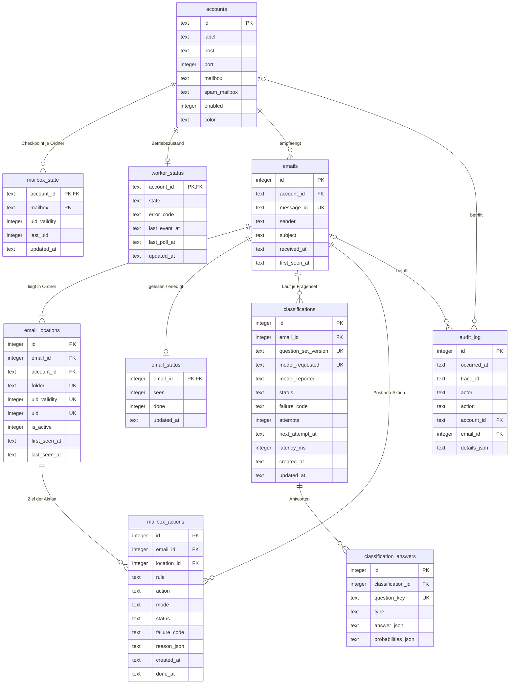

# E-Mail-Agent – Datenmodell (ERD + DDL)

Quelle der Wahrheit für das SQLite-Schema. Jede Migration `db/migrations/NNN_*.sql` enthält den DDL-Block ihres Abschnitts „DDL“ in diesem Dokument **wörtlich**; ein Test vergleicht beides (siehe unten). Das Schema speichert ausschließlich Metadaten, Klassifikationsantworten und Betriebszustand – nie Mailinhalte.

## ERD



Mermaid kann zusammengesetzte Eindeutigkeit nicht gruppieren. Maßgeblich sind die `UNIQUE (...)`-Klauseln im DDL unten:

- `emails`: `UNIQUE (account_id, message_id)` und `UNIQUE (id, account_id)` (Elternschlüssel für den zusammengesetzten FK).
- `email_locations`: `UNIQUE (account_id, folder, uid_validity, uid)`.
- `classifications`: `UNIQUE (email_id, question_set_version, model_requested)`.
- `classification_answers`: `UNIQUE (classification_id, question_key)`.
- `mailbox_actions`: partieller Unique-Index `(email_id, rule) WHERE rule <> 'undo'` (je Mail und Regel höchstens eine Aktion; Undo-Zeilen dürfen sich wiederholen).

## Entwurfsentscheidungen

1. **Logische Mail und Ort getrennt.** `emails` ist die Mail (Message-ID), `email_locations` ist ihr Platz in einem Ordner (UID/UIDVALIDITY gelten pro Ordner). Verschiebt der Provider eine Mail später von INBOX in den Spam-Ordner, kommt eine neue Location hinzu, die alte wird `is_active = 0`, und `audit_log` bekommt `folder_changed`. Kein Crash an einer globalen UNIQUE-Klausel, und die Klassifikation hängt an der logischen Mail.
2. **Mail ohne Message-ID** bekommt trotzdem eine `emails`-Zeile (`message_id` NULL; SQLite erlaubt mehrere NULLs in UNIQUE). Ihre Identität ist dann die Location.
3. **Zusammengesetzter FK** `(email_id, account_id) → emails (id, account_id)` stellt sicher, dass eine Location nie zu einem anderen Konto gehört als ihre Mail.
4. **Antworten normalisiert** in `classification_answers` statt fester Spalten. Ändert sich das Fragenset, ändert sich nur `question_set_version`, nicht das Schema. Abgeleitete Werte (z. B. `shadow_quarantine`) stehen dort mit `type = 'derived'`.
5. **`audit_log` ist append-only**, per Trigger erzwungen. Es nimmt auch Mail-Lebenszyklusereignisse auf (`folder_changed`, `source_gone`, `uidvalidity_reset`); eine eigene Tabelle `email_events` gibt es nicht.
6. **`worker_status` liegt in der DB.** Veryfront-Routen und CLI-Prozesse (`sample`, `eval`) teilen keinen Arbeitsspeicher mit `server.ts`. Routen lesen Betriebszustand deshalb nur aus SQLite.
7. **Kein Schwellwert in der DB.** `spam_threshold` kommt aus der Konten-JSON; der je Lauf angewandte Wert steht in der abgeleiteten Antwort.
8. **Zeitstempel** sind ISO-8601 UTC als TEXT (`2026-10-26T19:48:46.692Z`).
9. **Keine Inhaltsspalten.** Kein Body, Auszug, Rohquelle, Header-Rohdaten, Anhang oder Roh-Response. Absender (nur Adresse, kleingeschrieben) und Betreff sind die einzigen Mailinhalte in der DB; sie dürfen nie in Logs.
10. **Lese- und Erledigt-Status getrennt von der Mail (002).** `email_status` hat höchstens eine Zeile je Mail. `seen` kommt ausschließlich vom Provider (IMAP-Flag `\Seen`, nur gelesen, nie geschrieben); `done` setzt allein Nico in der App (nur App-DB). Eine fehlende Zeile bedeutet `seen = 0, done = 0`. Beide Werte sind unabhängig: Der Worker überschreibt nie `done`, die App nie `seen`. „Offen“ ist keine Spalte, sondern eine reine Funktion (Plan v5, 3.6).
11. **Kontofarbe in der DB (002).** `accounts.color` (`#rrggbb`, klein geschrieben, optional) wird beim Start wie `label` aus der Konten-Datei synchronisiert. Dadurch muss die API nie die Konten-Datei (mit Zugangsdaten) lesen, und der synthetische Modus hat Farben. Abweichung von Plan v5 D29 („kein Schema nötig“), begründet in `docs/DEVIATIONS.md`.
12. **Audit der App-Aktionen.** `email_done` und `email_undone` stehen mit `actor = 'system'` im `audit_log` (nur `email_id` und `account_id`, `details_json` leer). Ein eigener Akteur `nico` kommt erst mit der Rebuild-Migration von `audit_log` (Plan v5, Abschnitt 4), nicht vorher.

13. **Postfach-Aktionen (003, M7a).** `mailbox_actions` protokolliert jede automatische Schreibaktion auf dem Mailserver und jede, die nur geplant wäre (Trockenlauf). Sie speichert nur IDs, Codes und Zeitstempel; `reason_json` enthält nur kurze Codes und Zahlen (z. B. `{"rule_reason":"jev_spam"}`), nie Betreff, Absender oder Inhalt. `location_id` ist der aktive Ort der Mail zum Zeitpunkt der Aktion (Ordner, UIDVALIDITY und UID stehen dort). Die CHECK-Listen enthalten schon die Werte von M7 (`blacklist`, `quarantine`, `purge`, `move_*`), weil eine CHECK-Liste in SQLite nur per Tabellenumbau erweiterbar ist; M7a nutzt nur `rule` ∈ {`spam_seen`, `undo`} und `action` ∈ {`mark_seen`, `unmark_seen`}. Die Paarung ist per CHECK erzwungen (`undo` gehört zu `unmark_seen`/`move_inbox`, alle anderen Regeln zu den übrigen Aktionen). Status: `planned` (nur Trockenlauf), `done`, `failed` (mit `failure_code`), `undone` (die ursprüngliche Aktion wurde per Undo zurückgenommen). Der partielle Unique-Index macht die Ausführung idempotent und verhindert, dass eine zurückgenommene Aktion erneut greift. Die Migration trägt die Nummer 003, weil Plan v5 (Abschnitt 4) die geplante Migration `003` für Feedback/Absender (M5) erst später baut; diese wird `004`.
14. **Audit der Postfach-Aktionen.** `mailbox_action` steht mit `actor = 'system'` im `audit_log` (`details_json` nur mit `action_id`, `rule`, `action`, `mode`, `status`, `failure_code`). Ein eigener Akteur `rules` kommt erst mit der Rebuild-Migration von `audit_log` (zusammen mit `nico`).

## Verbindungs-Pragmas (nicht Teil der Migration, bei jeder Verbindung setzen)

```text
PRAGMA foreign_keys = ON;
PRAGMA journal_mode = WAL;
PRAGMA busy_timeout = 5000;
```

Der Migrationsrunner legt `schema_migrations (version INTEGER PRIMARY KEY, applied_at TEXT NOT NULL)` selbst an (`CREATE TABLE IF NOT EXISTS`) und führt `db/migrations/NNN_*.sql` numerisch sortiert und einmalig aus.

## DDL (`db/migrations/001_init.sql`)

```sql
CREATE TABLE accounts (
  id           TEXT PRIMARY KEY,
  label        TEXT NOT NULL,
  host         TEXT NOT NULL,
  port         INTEGER NOT NULL CHECK (port BETWEEN 1 AND 65535),
  mailbox      TEXT NOT NULL,
  spam_mailbox TEXT,
  enabled      INTEGER NOT NULL DEFAULT 1 CHECK (enabled IN (0, 1))
);

CREATE TABLE mailbox_state (
  account_id   TEXT NOT NULL REFERENCES accounts (id),
  mailbox      TEXT NOT NULL,
  uid_validity INTEGER NOT NULL,
  last_uid     INTEGER NOT NULL CHECK (last_uid >= 0),
  updated_at   TEXT NOT NULL,
  PRIMARY KEY (account_id, mailbox)
);

CREATE TABLE worker_status (
  account_id    TEXT PRIMARY KEY REFERENCES accounts (id),
  state         TEXT NOT NULL CHECK (state IN ('disabled', 'connecting', 'connected', 'backoff', 'paused')),
  error_code    TEXT,
  last_event_at TEXT,
  last_poll_at  TEXT,
  updated_at    TEXT NOT NULL
);

CREATE TABLE emails (
  id            INTEGER PRIMARY KEY,
  account_id    TEXT NOT NULL REFERENCES accounts (id),
  message_id    TEXT,
  sender        TEXT NOT NULL,
  subject       TEXT NOT NULL,
  received_at   TEXT NOT NULL,
  first_seen_at TEXT NOT NULL,
  UNIQUE (account_id, message_id),
  UNIQUE (id, account_id)
);
CREATE INDEX emails_account_received ON emails (account_id, received_at DESC);

CREATE TABLE email_locations (
  id            INTEGER PRIMARY KEY,
  email_id      INTEGER NOT NULL,
  account_id    TEXT NOT NULL REFERENCES accounts (id),
  folder        TEXT NOT NULL,
  uid_validity  INTEGER NOT NULL,
  uid           INTEGER NOT NULL,
  is_active     INTEGER NOT NULL DEFAULT 1 CHECK (is_active IN (0, 1)),
  first_seen_at TEXT NOT NULL,
  last_seen_at  TEXT NOT NULL,
  FOREIGN KEY (email_id, account_id) REFERENCES emails (id, account_id),
  UNIQUE (account_id, folder, uid_validity, uid)
);
CREATE INDEX email_locations_email ON email_locations (email_id);

CREATE TABLE classifications (
  id                   INTEGER PRIMARY KEY,
  email_id             INTEGER NOT NULL REFERENCES emails (id),
  question_set_version TEXT NOT NULL,
  model_requested      TEXT NOT NULL,
  model_reported       TEXT,
  status               TEXT NOT NULL CHECK (status IN ('pending', 'retry_wait', 'classified', 'failed', 'paused')),
  failure_code         TEXT,
  attempts             INTEGER NOT NULL DEFAULT 0 CHECK (attempts >= 0),
  next_attempt_at      TEXT,
  latency_ms           INTEGER CHECK (latency_ms IS NULL OR latency_ms >= 0),
  created_at           TEXT NOT NULL,
  updated_at           TEXT NOT NULL,
  UNIQUE (email_id, question_set_version, model_requested),
  CHECK (status <> 'classified' OR model_reported IS NOT NULL),
  CHECK (status <> 'failed' OR failure_code IS NOT NULL)
);
CREATE INDEX classifications_due ON classifications (next_attempt_at) WHERE status = 'retry_wait';

CREATE TABLE classification_answers (
  id                 INTEGER PRIMARY KEY,
  classification_id  INTEGER NOT NULL REFERENCES classifications (id),
  question_key       TEXT NOT NULL,
  type               TEXT NOT NULL CHECK (type IN ('noul', 'choice', 'score', 'derived')),
  answer_json        TEXT NOT NULL CHECK (json_valid(answer_json)),
  probabilities_json TEXT CHECK (probabilities_json IS NULL OR json_valid(probabilities_json)),
  UNIQUE (classification_id, question_key)
);

CREATE TABLE audit_log (
  id           INTEGER PRIMARY KEY,
  occurred_at  TEXT NOT NULL,
  trace_id     TEXT NOT NULL,
  actor        TEXT NOT NULL CHECK (actor IN ('worker', 'pipeline', 'sample', 'eval', 'system')),
  action       TEXT NOT NULL,
  account_id   TEXT REFERENCES accounts (id),
  email_id     INTEGER REFERENCES emails (id),
  details_json TEXT NOT NULL DEFAULT '{}' CHECK (json_valid(details_json))
);
CREATE INDEX audit_log_time ON audit_log (occurred_at DESC);
CREATE INDEX audit_log_email ON audit_log (email_id);

CREATE TRIGGER audit_log_no_update BEFORE UPDATE ON audit_log
BEGIN SELECT RAISE(ABORT, 'audit_log is append-only'); END;

CREATE TRIGGER audit_log_no_delete BEFORE DELETE ON audit_log
BEGIN SELECT RAISE(ABORT, 'audit_log is append-only'); END;
```

`audit_log.action` ist bewusst frei erweiterbar; im Code gibt es dafür einen Union-Typ. Vorgesehene Werte: `worker_connected`, `worker_backoff`, `worker_paused`, `worker_reconnect_forced`, `uidvalidity_reset`, `folder_changed`, `source_gone`, `classification_failed`, `jev_paused`, `shadow_quarantine_computed`, `sample_previewed`, `sample_started`, `sample_finished`, `eval_run`. `details_json` enthält nur IDs, Codes, Zähler und Ordnernamen, nie Betreff, Absender, Body oder Credentials.

## DDL (`db/migrations/002_status_and_account_color.sql`)

```sql
CREATE TABLE email_status (
  email_id   INTEGER PRIMARY KEY REFERENCES emails (id),
  seen       INTEGER NOT NULL DEFAULT 0 CHECK (seen IN (0, 1)),
  done       INTEGER NOT NULL DEFAULT 0 CHECK (done IN (0, 1)),
  updated_at TEXT NOT NULL
);

ALTER TABLE accounts ADD COLUMN color TEXT
  CHECK (color IS NULL OR (length(color) = 7 AND color GLOB '#[0-9a-f][0-9a-f][0-9a-f][0-9a-f][0-9a-f][0-9a-f]'));
```

`audit_log.action` kennt zusätzlich `email_done` und `email_undone`.

## DDL (`db/migrations/003_mailbox_actions.sql`)

```sql
CREATE TABLE mailbox_actions (
  id           INTEGER PRIMARY KEY,
  email_id     INTEGER NOT NULL REFERENCES emails (id),
  location_id  INTEGER NOT NULL REFERENCES email_locations (id),
  rule         TEXT NOT NULL CHECK (rule IN ('spam_seen', 'blacklist', 'quarantine', 'purge', 'undo')),
  action       TEXT NOT NULL CHECK (action IN ('mark_seen', 'move_quarantine', 'move_trash', 'move_inbox', 'unmark_seen')),
  mode         TEXT NOT NULL CHECK (mode IN ('dry_run', 'live')),
  status       TEXT NOT NULL CHECK (status IN ('planned', 'done', 'failed', 'undone')),
  failure_code TEXT,
  reason_json  TEXT NOT NULL DEFAULT '{}' CHECK (json_valid(reason_json)),
  created_at   TEXT NOT NULL,
  done_at      TEXT,
  CHECK ((rule = 'undo') = (action IN ('move_inbox', 'unmark_seen'))),
  CHECK (status <> 'failed' OR failure_code IS NOT NULL)
);
CREATE UNIQUE INDEX mailbox_actions_once ON mailbox_actions (email_id, rule) WHERE rule <> 'undo';
CREATE INDEX mailbox_actions_list ON mailbox_actions (mode, created_at DESC, id DESC);
```

`audit_log.action` kennt zusätzlich `mailbox_action`.

## Schema-Test (`tests/db.test.ts`)

- Jeder Abschnitt „## DDL (`db/migrations/NNN_name.sql`)“ hat genau einen SQL-Codeblock, der nach Whitespace-Normalisierung identisch mit der benannten Migrationsdatei ist; jede Migrationsdatei hat einen solchen Abschnitt (der Pragma-Block ist bewusst als `text` ausgezeichnet und gehört nicht dazu).
- Die Spaltenmenge jeder Tabelle (`PRAGMA table_info`) entspricht einer Allowlist im Test. Kein Spaltenname passt auf `/(^|_)(body|snippet|excerpt|raw|attachment|html|content|spam_threshold)($|_)/i`.
- FK-Verstöße, zusammengesetzter FK (Location eines fremden Kontos), alle UNIQUE- und CHECK-Klauseln, `json_valid`-Checks und beide Append-only-Trigger werden mit je einem Verstoß-Test belegt.
- Die drei Pragmas sind auf **jeder** geöffneten Verbindung aktiv.
